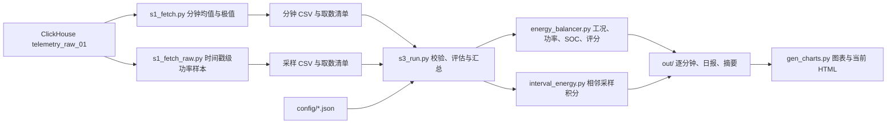

# 卫星能源评估项目：当前框架、原理与计算依据

> 版本基准：2026-10-23 工作区 v2.3，评估对象 SCS-01-01。本文描述**当前代码实际执行的口径**；历史 09/10 号报告按接收时间聚合的 4738 分钟及其能量数值不再适用。生产复算数值取自本地 `out/energy_v2_summary.json`，取数窗口见第 2 节。

> **2026-10-26 增补**：本文保留 v2.3 整星核心口径；单机可配置部件、`value_str` 状态取数和分流前物理平衡的现行实现见 [16 号文档](16_单机能源部件配置与功率平衡.md)。下文的历史取数行数描述的是原五项电源测点版本。

## 1. 项目定位与总体架构

本项目是基于在轨遥测的**回顾性观测样本评估**：从 ClickHouse 提取星上时间对齐的电源遥测，计算母线侧功率、日照/地影工况、电压映射 SOC、已观测间隔内的能量及样本健康评分，再生成 CSV、JSON 和离线 HTML。它目前不预测未来轨道供能，也不估算电池实际容量、SOH 或全期健康状态。



| 层次 | 当前模块 | 输入与职责 | 主要产物 |
|---|---|---|---|
| 连接与取数 | [`ch_http.py`](ch_http.py)、[`s1_fetch.py`](s1_fetch.py)、[`s1_fetch_raw.py`](s1_fetch_raw.py) | 从环境变量或被忽略的 `.env` 读取连接信息；用原生 9000 端口按卫星、参数和半开时间窗分批取数 | 两份 CSV 及各自 SHA-256 清单 |
| 数据整形与编排 | [`s3_run.py`](s3_run.py) | 校验 CSV、卫星 ID、时间基准、清单匹配及哈希；将分钟长表透视为按时间索引的宽表 | 评估输入、结果 CSV、摘要 JSON |
| 物理与统计 | [`energy_balancer.py`](energy_balancer.py) | 清洗遥测、计算功率、判定工况、映射 SOC、统计百分位与评分 | 每分钟计算量、名义分钟能量、健康指标 |
| 时长积分 | [`interval_energy.py`](interval_energy.py) | 对短于阈值的相邻星上时间戳做梯形积分 | 按工况的已观测间隔能量 |
| 展示 | [`gen_charts.py`](gen_charts.py)、[`config/charts.json`](config/charts.json) | 从结果与摘要生成 SVG，并嵌入当前 HTML | `framework_documentation_current.html` |

`03`/`04`/`05` 号工具与 `q1–q5`、`s2/s4/s5` 为历史或探索脚本；现行主链入口是 `s1_fetch.py`、`s1_fetch_raw.py`、`s3_run.py`、`gen_charts.py`。生产 CSV、清单、`out/` 与图表副本不入 Git；当前 HTML 和方法文档属于可审阅产物。

## 2. 数据来源、时间与质量契约

现行数据源是 `prod_cluster` 中的 `chdb_3body.telemetry_raw_01`（16 列长表），不是 `chdb_3body.master_satellite_01`（约 3454 列宽表）。本次读取使用用户指定的 ClickHouse **9000 原生端口、无 TLS 握手**，仅限只读生产查询；带口令明文连接需显式放行，默认被客户端拒绝。连接配置见 [`.env.example`](.env.example)，实际口令不得写入仓库。

时间窗为北京时间 **[2025-12-26 00:00, 2026-08-12 00:00)**，左闭右开。`onboard_time_bj` 用于聚合与积分；样本中它比 `onboard_time_utc` 晚 8 小时。`station_time` 是地面接收时间，按它聚合会把不同星上时刻错并。实测服务器时区为 `Asia/Shanghai`；取数函数要求显式传 `--source-timezone Asia/Shanghai`。

| 文件 | 查询与数据粒度 | 当前清单记录 |
|---|---|---:|
| `data_power_minute.csv` | `toStartOfInterval(onboard_time_bj, 1 MINUTE)` × `param_code`；`count/avg/min/max/stddevSamp(value)`，排除空值 | 414,267 行；19,727 个不同星上分钟 |
| `data_power_raw.csv` | `onboard_time_bj` × `param_code`；同一时间戳同一代码的重复记录先取 `avg(value)`，再输出一行；因此它是**时间戳级聚合样本**，不是数据库事件逐行原样导出 | 690,565 行；138,113 个不同时间戳 |

两条查询都限定 `satellite_id='SCS-01-01'`、参数代码和时间窗，默认按 7 天分批、流式写 CSV。成功后才替换目标文件。`s3_run.py` 拒绝无效时间、重复的 `t/param_code`、清单哈希不符，以及分钟/采样清单在卫星、源表、时间窗、时区或时间列上的不一致。没有分钟清单的旧 CSV 标为 `unverified_legacy_input`；`verified_fetch_manifest` 表示本地文件与清单一致，**不等于测点物理定义已独立验证**。

遥测映射来自 [`config/telemetry_params.json`](config/telemetry_params.json)：

| 代码 | 当前解释 | 用途 |
|---|---|---|
| TMD009 | 太阳阵总电流 `I_solar`，A | 日照判据及帆板/母线差额诊断 |
| TMD016 | 母线电压 `V_bus`，V | 功率计算与稳定度 |
| TMD017 | 母线电流 `I_bus`，A | 测点相对 PCDU 充电支路的位置待连接图确认 |
| TMD018 | 负载电流 `I_load`，A | 主负载功率 |
| TMD019 | 蓄电池电压 `V_bat`，V | 设计放电曲线映射 SOC |

TMD003–008、TMD010–015 供太阳阵分板图表使用；TMD023/024/066/067 不进入整星核心功率公式，现已在单机部件明细中分别输出。测点名称与单位依据配置和原始遥测表；TMD017 的电路位置、TMD018 是否涵盖全部负载仍需电源分系统图纸或独立测量最终确认。

## 3. 物理原理与功率口径

用户提供的供配电方案 5.3.3 明确采用**不调节一次母线 + 六级 S³R 顺序开关分流**，母线电压由蓄电池组充放电电压钳位。光照期先供母线负载，再充蓄电池，最后对满电后的剩余输出分流；阴影期由电池供电，日照短时供电不足时太阳阵与电池联合供电。“通过 PCDU 充电”不能推出“绕过母线充电”：PCDU 的充电控制与公共母线可以共存。文字没有给出 TMD017 电流传感器相对充电支路的位置，须用方案所述系统连接图核对。原先由 TMD017−TMD018 的差额推断“含充电支路”的结论降为待核假设。

设计摘录同时列出母线 23.1–29.2 V、最大功率 1178 W 和最大电流 29.6 A；`1178/29.6≈39.8 V`，超出所列电压范围。这组额定值在原图表复核前不用于设置功率阈值。

逐时间点的计算为（电压 V、电流 A、功率 W）：

| 量 | 公式 | 可解释范围 |
|---|---|---|
| TMD017 测点折算功率 `P_solar`（历史字段名） | `V_bus × I_bus` | 使用 TMD016×TMD017；是否覆盖充电支路待核，地影近零负值不是物理负发电 |
| 负载功率 `P_load` | `V_bus × I_load` | 使用 TMD016×TMD018；是否覆盖全部负载取决于测点拓扑 |
| 两测点功率差额 `P_excess` | `P_solar − P_load` | 可按相反符号暂判电池方向，但不是电池支路功率，也不独立证实方向 |
| 电池净功率历史代理 | `P_excess` | 保留兼容计算，不得解释为独立电池支路功率 |
| 差额正负拆分（历史字段） | `P_charge_est=max(P_excess,0)`；`P_disch_est=min(P_excess,0)` | 字段名不证明实际充电或放电 |
| TMD009 与 TMD017 差额诊断 `P_shunt_diag` | `(I_solar−I_bus)×V_bus` | 可能包含充电支路及测点电压/时序差异，不能称为分流损耗 |

因此 `P_solar − P_load − (P_charge_est + P_disch_est) ≡ 0` 是**代数恒等式**，不是物理闭合通过的证据；充电支路在 TMD017 测点之前分出时，差额更不能作为电池功率。当前实现将非有限值转为空值，并对 `V_bus/V_bat` 限在 10–45 V、`I_solar/I_load` 限在 0–100 A、`I_bus` 限在 −5–100 A；这些是软件裁剪边界，不是设备合格范围，越界原值可能被截断而影响统计。

稳态应先在整个供配电边界核账：`太阳阵实际输入 + 电池端放电 = 负载端输入 + 电池端充电 + 分流及供配电总耗散 + 残差`，暂态另计母线储能变化。地影期公共母线账本暂记为 `P_电池放电,母线侧=P_全部负载+P_其他+dE_母线/dt`，其中 `P_其他` 为待核的未分解项，不直接命名为母线损耗或热控功率；光照充电为 `P_SA_node=P_load_all+P_B_ch_bus+P_bus_loss+dE_bus/dt`，光照短时不足时须把电池母线侧放电加在输入侧。阵列/S³R 分流另列边界，具体能量积分式见 [16 号文档](16_单机能源部件配置与功率平衡.md)。若要拆出母线与 S³R 两处损耗，必须知道 TMD017 与充电分支、分流节点的位置，并取得同边界独立测量。六组太阳阵端 `V×I` 与 `TMD016×TMD017` 的逐分钟差额保留在 `P_panel_terminal_to_bus_difference_W`；当前阵列电压测点异常，不能单凭正值命名为 S³R 总耗散。按光照或最大功率点估计的“可用功率”只是潜在能力。蓄电池电压 `TMD019` 已有，主分析分钟输入与局部图均纳入 CH 的 `TMH025` 电流幅值和 `TMD074_b1` 放电开关状态。按用户确认的规则，开关为“通”时给 `TMH025` 幅值赋放电正号；“断”、同分钟切换或缺测时不自动赋充电负号。`I_负载−I_TMD017` 只保留为跨测点冲突诊断，不再用于赋号。该方向是规则派生值，不是 TMH025 原生方向码；电池电流工程值、测点端口和充电路径仍待核，故母线损耗仍不能定值。

## 4. 工况判定与 SOC/DoD

**分钟工况**使用 TMD009 在该分钟的原始最小值 `mn` 和最大值 `mx`，阈值为 [`sun_I_threshold_A=1.0`](config/design_params.json)：

```text
mn ≥ 1 A 且极值有效             → 日照
mx < 1 A 且极值有效             → 地影
跨阈值、极值缺测或 mn > mx       → 未判定
```

这种判定要求整分钟内证据一致。仅对缺少分钟极值的旧输入，代码才使用按时间缺口分段的 5 样本滚动多数表决；当前生产数据走极值分支。原始采样积分另以每个端点的 TMD009 判定日照/地影；相邻端点工况不一致时，该**间隔**归为未判定。两种工况粒度不同，不应逐条强求相同数量。

**SOC** 使用 [`config/v_soc_curve.json`](config/v_soc_curve.json) 的 SCS-01-01 设计放电表：`V_bat` 为横轴、SOC 比例为纵轴，在表点间线性插值；表外电压饱和到边界。当前表为 **10 A 恒流放电、7s13p/65 Ah 设计构型**，22.82 V→10%，29.31 V→100%。代码再以 `soc_floor=5%` 截断，但当前曲线下限已是 10%，所以该 floor 不改变当前结果。`DoD = (1−SOC)×100%`。`V_bat` 缺测时 SOC/DoD 保持空值，不用上一分钟补齐；统计分位数仅取有电压锚定的样本。

该 SOC 是**电压映射估计**。充电滞回、电流倍率、温度及电池老化未建模，也没有独立在轨 SOC 校验。额定 65 Ah 和容量下限 60.3 Ah 已登记为设计约束，当前算法并未用它们计算容量或 SOH；配置中的 `capacity_map_Ah`、充放电效率 0.97 与太阳阵额定 900 W 也未参与当前主链计算，其中 900 W 仍是假设值。

## 5. 两种能量计算：主结果与对照量

### 5.1 主结果：相邻采样间隔梯形积分

[`interval_energy.py`](interval_energy.py) 先在每个星上时间戳计算 `P_solar` 和 `P_load`。只接受 `0 < Δt ≤ 10 s` 且两端功率均有限的相邻时间戳；对每个有效间隔及功率量 `P`：

```text
ΔE_kWh = [P(t_i) + P(t_{i+1})] / 2 × Δt_seconds / 3,600,000
```

分别累加日照、地影和未判定间隔。`E_batnet = E_solar − E_load` 仍是差额推算。超过 10 秒的间隔**不插值、不外推**；功率缺测间隔也排除。该模型仍假设短间隔内功率线性变化，且结果对 10 秒阈值敏感。当前 HTML 主能量表采用此方法。

### 5.2 对照量：分钟名义 60 秒等效能量

[`energy_balancer.py`](energy_balancer.py) 的 `phase.e_*` 对每个有效观测分钟用 `P_minute × 60/3,600,000` 折算 kWh，并按工况求和。它没有跨未观测分钟补点，却仍假设**每个有观测的分钟都代表完整 60 秒**；对突发式采样不能当作实际发电时长积分。`gen_charts.py` 的按小时能量图也是这类名义等效量，标题已标注。它与主结果口径不同，不能相加或混用。

## 6. 综合指标与样本评分

| 指标 | 实现公式与样本范围 | 当前阈值 |
|---|---|---|
| 日照 TMD017/负载测点差比（历史评分项） | `(明确日照分钟 P_solar 均值 − P_load 均值) / P_load 均值 ×100%` | ≥20% 得 100；≤0% 得 40；中间得 70；非充电裕度 |
| DoD p95 | 所有 `V_bat` 有效观测分钟的 DoD 95 分位 | ≤30% 得 100；≥50% 得 40；中间得 70 |
| SOC p5 | 同上样本的 SOC 5 分位 | ≥50% 得 100；≤30% 得 40；中间得 70 |
| 母线稳定度 | `(全体有效 V_bus 的 p95−p5)/中位数 ×100%` | ≤3% 得 100；≥5% 得 40；中间得 70 |

四项权重依次为 **0.35/0.25/0.20/0.20**，按可得分项权重归一化后求和。缺一项时分母只含其余权重，因此 `health.coverage` 表示**评分分项权重覆盖率**，不是时间覆盖率。当前分项为 100/100/100/70，故 `94 = 100×0.35 + 100×0.25 + 100×0.20 + 70×0.20`。90/75/60 分分别是“优秀/良好/一般”的等级边界，低于 60 为“较差”。

`calendar_minute_coverage = 观测唯一分钟数 / (首末观测时间跨度÷60秒 + 1)`，分母是**首末实际观测时刻**之间的日历分钟，而非整个查询窗口。当前为 **6.05%**。评分的 `scope` 固定为“观测样本”，`period_assessment=null`；94 分既不能推广为整段时期的健康判定，也不能证明充电能力或整星物理闭合，因为其功率项使用测点差比。

## 7. 当前生产复算与证据边界

| 项目 | 当前值 | 解释 |
|---|---:|---|
| 观测分钟 / 工况 | 19,727；日照 12,993、地影 6,517、未判定 217 | 星上北京时间分钟聚合 |
| 原始时间戳 / 超阈值间隔 | 138,113 / 22,745 | 阈值 10 秒 |
| 可积分时长 | 约 414,674 秒 | 仅有效短间隔之和 |
| 日照 TMD017 测点折算 / 负载 | 29.595 / 11.916 kWh | 原始采样间隔积分；非已确认的太阳阵总输出 |
| 地影 TMD017 测点折算 / 负载 | −0.103 / 7.716 kWh | 微小负值是近零负读数，不代表负发电设备 |
| 未判定 TMD017 测点折算 / 负载 | 0.010 / 0.045 kWh | 不强行归入日照或地影 |
| 测点差比 / DoD p95 / SOC p5 / 母线稳定度 | 150.4% / 21.8% / 78.2% / 4.93% | 差比不是实际充电裕度 |
| 评分 | 94 分，整段时期未评定 | 评分覆盖率 1.0 仅指四个分项均可算 |

将积分缺口阈值改成 **6/10/15 秒**，TMD017 测点折算能量约为 **26.022/29.501/36.764 kWh**；阈值不是无关紧要的实现参数。作为对照，日照分钟按完整 60 秒折算为 **79.644 kWh**，不能作为实际时长发电量。

独立电池支路校验仍缺：[知识 YAML](../Data/002-三体星/002_santi_knowledge_第三部分原始.yaml)/[《01星遥测大表.xlsx》](../Data/002-三体星/01星遥测大表.xlsx)将“蓄电池组母线电流检测”记作 `TMU146`，生产参数字典无该代码；另有同名 `TMH025`，但两者系数不同，生产字典单位为空。用户已确认 CH 的 `TMH025` 单位为 A，并确认放电开关“通”表示放电。现行分析按此规则赋放电正号；同一观测分钟的电流差额有大量相反方向，作为测点冲突单列。仍须核实数值编码、测量端口及充电路径；派生电流暂不能用于确认物理闭合或电池净电量。详情见 [16 号计算依据](16_单机能源部件配置与功率平衡.md)。

## 8. 复现、产物与待验证事项

按 [README 的运行步骤](README.md#快速开始)安装依赖、配置本地连接后，在 `ResearchSpace` 中依次执行：

```bash
python s1_fetch.py --start 2025-12-26 --end 2026-08-12 --source-timezone Asia/Shanghai
python s1_fetch_raw.py --start 2025-12-26 --end 2026-08-12 --source-timezone Asia/Shanghai
python s3_run.py
python gen_charts.py
```

摘要 `out/energy_v2_summary.json` 保存两份数据清单、配置哈希和 `energy_balancer.py`/`s3_run.py` 的代码哈希。当前**尚未把取数脚本及 `interval_energy.py` 的代码哈希纳入摘要**，因此哈希可验证部分产物一致性，不能单凭摘要证明完整计算环境可重现。`out/energy_v2_result.csv` 是逐分钟计算量，`out/energy_v2_daily.csv` 是按日的已有分钟均值，当前 HTML 展示主积分结果和图表。

回归入口为 `python -m unittest discover -s tests -q` 与 `python test_chart_documentation.py -q`；合成端到端用例在无生产数据的 CI 中运行，真实数据图表用例依赖本地未入库数据。当前工作区最近验证为 **51 项核心测试、11 项图表测试通过**，并通过编译检查、文件/配置哈希核对与 `git diff --check`。

后续要提升结论强度，优先取得：① TMD017/TMD018/TMH025 的电路测点图、单位、换算和符号方向；② 原始采样机制，以确认短间隔线性积分和缺口阈值；③ 电池充放电实测与温度，用于 V–SOC 标定及容量/SOH 估算；④ 可发布全期评分所需的轨道/工况覆盖准则。上述证据到位前，维持“观测样本、模型估计”的表述。

## 9. 主要依据索引

| 依据 | 支持的结论 | 边界 |
|---|---|---|
| [`energy_balancer.py`](energy_balancer.py)、[`interval_energy.py`](interval_energy.py)、[`s3_run.py`](s3_run.py) | 当前公式、缺测与工况逻辑、摘要结构 | 以当前工作树实现为准 |
| [`config/design_params.json`](config/design_params.json)、[`config/v_soc_curve.json`](config/v_soc_curve.json)、[`config/telemetry_params.json`](config/telemetry_params.json) | 阈值、权重、设计曲线与遥测代码 | 登记参数不等于都已参与计算或完成在轨标定 |
| [`s1_fetch.py`](s1_fetch.py)、[`s1_fetch_raw.py`](s1_fetch_raw.py)、本地两份取数清单 | 数据源、时间窗、聚合方法、文件哈希 | 清单不保证物理测点语义正确 |
| [`tests/`](tests/)、[`test_chart_documentation.py`](test_chart_documentation.py)、[CI](../.github/workflows/ci.yml) | 软件行为和离线链路回归 | 测试通过不构成电源物理模型验证 |
| [`14_整改实施与复算报告_v2.3.md`](14_整改实施与复算报告_v2.3.md)、`Data/002-三体星` 原始资料 | 本次生产只读核查、数值和资料差异 | 09/10/13 号部分历史数值与旧时间基准不可作为现行结果 |
