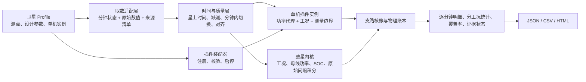

# 单机插件化能源平衡：框架与技术路线（草案）

> 状态：DRAFT，供方案评审；2026-10-26。依据当前 01 星代码、配置、遥测大表映射和本地复算结果。本文描述下一阶段的目标架构；标为“拟增加”的接口尚未实现。

## 1. 目标与设计决定

目标是让每颗卫星通过配置选择能源相关单机、遥测和工况规则，在统一时间轴上给出**可追溯的单机功率、整星负载与物理平衡状态**。这里的“热插拔”指**一次评估开始时装配或禁用插件实例**；不要求在正在运行的评估中动态替换代码。

**设计决定：一个插件实现一种计算或状态解释方法，一条卫星配置实例代表一台单机或一条明确的供电支路。**同一 `bus_current` 插件可供多台路由器、智算机使用；只有计算方法确实不同的设备才增加 Python 插件。这样避免为 94 个槽位各写一份相似代码，也保留专用设备的扩展点。

## 2. 框架



| 层 | 当前实现 | 下一阶段重点 |
|---|---|---|
| 卫星 Profile | `config/{telemetry_params,design_params,v_soc_curve,components}.json`；`--profile-dir` 选择 | 给每台单机明确测量位置、单位、符号、上级配电支路及是否与其他测点重叠；隔离不同卫星的自定义插件命名空间 |
| 取数 | `s1_fetch.py` 取分钟长表、`s1_fetch_raw.py` 取五项核心原始采样；CSV 与 SHA-256 清单 | 对源表或时间语义不同的卫星引入取数适配器；按启用插件扩展原始采样测点 |
| 单机插件 | `components.py` 注册 `vi`、`bus_current`、`power`、`state`；配置可列 `plugin_modules` | 固定插件输入/输出协议、版本、单位和缺测策略；专用插件仅处理真实差异 |
| 整星内核 | `energy_balancer.py` 计算主测点与工况，`interval_energy.py` 做短间隔积分 | 保持整星主测点独立，避免用未经核实的支路和替代总负载 |
| 核账/报告 | `s3_run.py` 合并单机与整星结果，`gen_charts.py` 输出 HTML | 增加供电拓扑核账、单机原始能量、闭合证据等级及误差预算 |

当前 01 星启用 94 个槽位：6 组太阳阵端测点、25 路负载功率支路、63 项状态或辅助测点（其中 48 路加热器开关）。**槽位数量不等于 94 台已测得功耗的单机**；状态型槽位不能换算瓦数。

## 3. 数据与插件契约

每个单机实例至少有 `id`、`role`、`plugin`、`enabled`、遥测代码及可选工况代码。现行 `ComponentPlugin` 声明必需字段、功率口径、计算函数、是否仅作上下文以及是否使用母线电压。`required_codes()` 汇总启用实例的测点，取数和评估使用同一卫星 Profile。旧 `model` 字段仍兼容。

下一阶段拟给插件输出统一增加以下元信息，而不是只返回一个 W 序列：

| 字段 | 作用 |
|---|---|
| `power_W`、`mode` | 同一时间基准上的功率与工况；无法计算时为空，不按零处理 |
| `quality` | 有效、缺测、分钟内切换、单位未核实、边界未核实等状态 |
| `basis` | 实测功率、同机 `V×I`、母线等效 `V×I`、额定值模型或纯状态 |
| `boundary` | 阵列端、PCDU 支路、母线端、电池端等测量位置 |
| `source_codes`、`plugin_version` | 计算所用遥测和插件版本，进入来源清单 |

**工况关联必须是显式映射。**只有确认状态遥测和功率测点属于同一单机，才发布“某工况下的功率”。当前科学载荷 `TMX020/021` 与 `TMX026` 可按同分钟状态分组；10G/100G 激光状态尚未证实对应激光处理机 1/2 的供电支路，不能直接发布其通信模式功耗。分钟内多状态保留“分钟内切换”，不自动填充缺测状态。

## 4. 两级功率账本

### 4.1 当前可计算的观测账本

```text
P_solar_to_bus = V_bus × I_solar_to_bus
P_load_total   = V_bus × I_load_total
P_net_est      = P_solar_to_bus − P_load_total
```

`P_net_est` 只能说明母线主测点差额。把它拆成 `P_charge_est` 和 `P_disch_est` 后得到的零残差是代数恒等式，**不能验证电池支路、分流或损耗**。六组太阳阵端 `V×I` 与母线端之差也只作测点边界诊断。

### 4.2 待独立测量的物理账本

设计方案 5.3.3 给出的功能拓扑为不调节母线、蓄电池电压钳位母线、六级 S³R 分流；光照期按“先供负载、再充电、最后分流”运行，阴影期由电池供电，光照短时不足时联合供电。PCDU 负责充电控制，并不意味着电池绕过公共母线。要细分母线与阵列/S³R 损耗，仍须取得方案所述连接图，确认 TMD017 和电池支路的相对位置。

在稳态、功率和损耗均取非负方向量时，先核对整个供配电边界：

```text
P_SA_actual_into_power_system + P_battery_discharge
    = P_load + P_battery_charge + P_shunt + P_distribution_and_control_loss + residual
```

`P_solar` 历史字段只等于 `TMD016×TMD017`，不能在测点位置未核实时认定它包含电池充电支路。若 TMD017 位于充电分支之后，`P_solar−P_load` 不是电池功率；若它位于分支之前，也仍需核实其他负载、损耗和电池电流方向。暂态需计入母线储能变化 `dE_bus/dt`，不同端口之间的线路/控制压降须列入相应损耗。

六组太阳阵端 `V×I` 之和减去 `TMD016×TMD017` 已能算出逐分钟**测点差额**。只有核实六组测点处于分流前、完整覆盖相关阵列支路，且 TMD017 测点之前没有未计入的充电分支，并确认采样同步，才能进一步解释为选定边界的总耗散候选。独立测得母线侧有符号电池功率，才能推算母线损耗。`TMD019` 电池电压已在当前输入中；用户已确认 CH 的 `TMH025` 单位 A，但当前输入未包含它，数值编码、方向和位置仍需核实。若 `P_load` 已在单机输入端计量，单机内部耗散已包含在负载中，不能再次加入整星账本。受控阵列未产生的潜在电功率不能直接记为 S³R 发热。

`P_SA_actual_before_shunt` 是选定分流节点前**实际产生并流入电路的电功率**。按光照或最大功率点估算的 `P_SA_available` 只是潜在能力；分流改变阵列工作点时，潜在与实际电输出之差不一定是分流器耗散的电功率。现行 `solar_available` 角色保留作历史兼容，但不参与物理闭合；闭合输入要求 `solar_pre_shunt_actual`。

现行 `physical_balance.status=unavailable` 是正确结果。下一阶段拟将“可闭合”判定改为证据门控：来源独立、单位和符号已核、测点边界一致、采样可对齐、缺测率可接受，并且残差的不确定度可计算。配置中的 `balance_boundary_verified=true` 只能作为人工声明的一部分，不能单独证明物理闭合。

## 5. 分阶段技术路线

1. **固定卫星 Profile 和插件契约。**在 `components.py`、配置及相邻测试中定义插件版本、输入/输出元数据、加载失败的明确错误；不同卫星的专用插件使用独立命名空间。`s1_fetch.py` 与 `s3_run.py` 校验启用插件所需测点及配置哈希。若新星使用不同源表或非 `onboard_time_bj` 语义，先增加取数适配器。
2. **建立单机—工况—供电支路映射表。**依据遥测大表和供电拓扑逐项标记“已证实、待核、无功率测点”。在 `components.json` 中只启用已证实的工况映射；输出每台单机的工况样本数、功率分布和缺测比例。对路由器主/备、智算机、激光通信机优先核对。
3. **做支路核账。**为支路定义上级母线、是否重叠、是否属于总负载测点。仅在支路完整且互不重叠时计算可解释的分解；其他情况保留有符号诊断差额。当前 25 路支路同分钟全部有效仅 953 分钟，其中 897 分钟支路和超过 `TMD018×TMD016`，必须先解决测量边界或标定问题。
4. **扩展单机原始采样能量。**按启用插件取原始电压、电流或功率，规定同源/异源对齐容差、时间戳与间隔有效条件；只对有效短间隔积分，分别给出观测时长、覆盖率和 kWh。现行“分钟均值电压 × 分钟均值电流”只作为功率代理，不直接乘 60 秒声称真实单机电量。
5. **开放物理闭合。**先取得供配电连接图，定位 TMD017、TMD018、TMH025 与 PCDU 充电/分流支路；再取得同边界的太阳阵实际输出和有符号电池支路功率，才能按正确路径分算阵列/S³R 与母线损耗。若要核验非构造残差，还需独立损耗测量。报告测量误差与未观测区间；缺少独立核验量时不把差额估计宣称为物理闭合。

## 6. 验收方式与待确认输入

| 验收点 | 检查证据 |
|---|---|
| 换星或禁用单机不会污染另一颗星的插件/测点 | 两个 Profile 在同一进程依次评估；输出测点清单、插件版本和结果各自匹配 |
| 单机工况可信 | 同机状态映射样例；缺测、未映射、分钟内切换和跨时间缺口用例 |
| 整星结果不因添加状态测点漂移 | 原核心分钟记录、工况、原始间隔积分及评分与基线逐项比较 |
| 支路求和不冒充整星总负载 | 重叠支路、缺失支路与负差额样例；只有拓扑核实后才报告剩余负载 |
| 物理平衡不是代数构造 | 独立输入下非零残差测试；缺传感器或边界未核时保持 `unavailable` |

需要外部确认的资料：各单机/加热器供电拓扑及支路电压、路由器和激光状态码到供电支路的对应关系、分流前实际阵列输出与分流/电池支路的独立测点及符号、其他卫星的源表与星上时间语义。在这些资料到位前，框架可以配置和分析已有观测，但不输出未经证实的单机耗能或完整物理闭合结论。

## 7. 相关实现

- 当前装配与计算：[`components.py`](components.py)、[`config/components.json`](config/components.json)
- 取数与评估：[`s1_fetch.py`](s1_fetch.py)、[`s1_fetch_raw.py`](s1_fetch_raw.py)、[`s3_run.py`](s3_run.py)
- 整星内核与积分：[`energy_balancer.py`](energy_balancer.py)、[`interval_energy.py`](interval_energy.py)
- 已核对的 01 星测点和物理边界：[`16_单机能源部件配置与功率平衡.md`](16_单机能源部件配置与功率平衡.md)

评审状态：草案。尚未经过独立架构评审；本文不代表后续阶段已实现。
