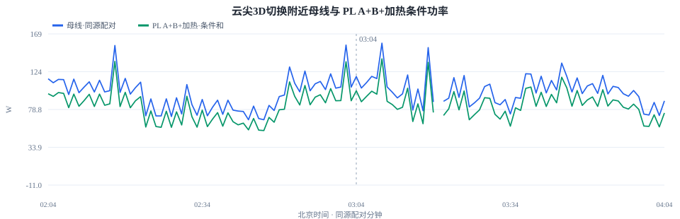

# 云尖3D星整星能源评估（UTC 宽表复算）

## 来源、时间和代号

来源为 `chdb_3D.yc_history` 宽表，时间列 `timestamp` 类型为 `DateTime64(3,'UTC')`。按北京时间半开窗口 `[2026-07-24 00:00:00, 2026-10-28 00:00:00)` 取数；数据库内存在超出当前日期的异常时间记录，未纳入本窗口。工作簿为 [云尖3D星遥测大表](../../../Data/0010-云尖3D星/云尖3D星_遥测大表0813.xlsx)，校验哈希和查询边界见[来源摘要](energy_summary.json)。[代号配置](config/telemetry_params.json)依据 EPS A 路和姿控状态表逐项重配。

| 用途 | 本星代号 | 工作簿名称 | 计算用法 |
|---|---|---|---|
| 母线电压 | `TMEA003` | 母线电压遥测 | 功率电压基准 |
| 母线电流 | `TMEA004` | 母线电流遥测 | 母线测点功率；全部负载覆盖范围待核 |
| 电池输出电压 | `TMEA005` | 蓄电池输出电压遥测 | 电池端电压 |
| 电池充放电电流 | `TMEA006` | 充放电电流遥测 | 保留原生正负号的电池端条件试算 |
| 太阳阵电流 | `TMEA007` | 太阳阵电流遥测 | 工况回退及母线电压折算代理 |
| 光照标志 | `TMZS003` | 计算的光照区标志 | 主判据；分钟内切换不归类 |
| 放电开关 | `TMEA001` | 放电开关状态 | 上下文；不改写电流符号 |

`TMEB003/006/007` 属 B 路备份诊断，工作簿中 `TMEB004/005` 标为“/”，本轮不把 B 路当作独立总功率测点。BCR PV 输入侧电压代号及在轨值已核验，阵列片端边界仍待核；各负载支路总和、PCDU 边界尚未核实。

## 数据覆盖与质量

EPS A 路有 6,245,121 条来源记录、5,255,368 个唯一 UTC 时间戳；合并完全重复或可合并记录 989,753 条，冲突时间戳 591 个。首末实测为 **2026-07-24T09:11:59.324000+08:00 至 2026-10-27T05:21:49.183000+08:00**，其间有数据 103,736 分钟，日历分钟覆盖率 75.96%。工况判据冲突 226 分钟，长于 10 秒的相邻采样缺口 398 个。

分钟文件保留各测点可解析原值的最小、均值和最大；超出工作簿量程的值不从原值图删除。功率和短间隔积分仅使用范围内的配对样本。逐项计数见[机器分析摘要](analysis_summary.json)和[逐分钟数据](data_power_minute.csv)。

| 遥测 | 代号 | 超工作簿量程的唯一样本 | 未筛选原值最小 | 未筛选原值最大 |
|---|---|---:|---:|---:|
| 母线电压遥测 | `TMEA003` | 457 | 0.550 | 579.081 |
| 母线电流遥测 | `TMEA004` | 498 | -12.625 | 505.127 |
| 蓄电池输出电压遥测 | `TMEA005` | 501 | 0.750 | 579.848 |
| 充放电电流遥测 | `TMEA006` | 3,498 | -25.200 | 897.624 |
| 太阳阵电流遥测 | `TMEA007` | 1,278 | -24.800 | 851.295 |

## 工况与功率

光照优先按 `TMZS003` 的“光照区/阴影区”判断；缺测时按同分钟 `TMEA007` 极值与 1 A 阈值回退。`P_solar_proxy=TMEA003×TMEA007` 是**太阳阵电流在母线电压下的代理功率**，不是太阳阵端实际发电；`P_bus=TMEA003×TMEA004` 是母线电流测点功率；`P_battery_trial=TMEA005×TMEA006` 保留电池电流原生符号。地影电池电流为正、日照常接近零或为负，方向与放电假设相符，但最终仍需连接图核准。

| 工况 | 分钟 | 太阳阵电流中位 A | 母线电流中位 A | 电池电流中位 A | 太阳阵代理中位 W | 母线测点中位 W | 电池试算中位 W |
|---|---:|---:|---:|---:|---:|---:|---:|
| 日照 | 101,628 | 4.311 | 3.817 | 0.004 | 122.7 | 108.7 | 0.1 |
| 地影 | 1,717 | 0.435 | 4.726 | 4.677 | 12.2 | 132.6 | 132.4 |
| 未判定 | 391 | 3.155 | 4.171 | 1.100 | 101.8 | 119.1 | 30.2 |

跨测点残差 `P_solar_proxy+P_battery_trial−P_bus` 只用于发现不一致；不同电压侧和支路边界未对齐，不能命名为母线损耗或物理闭合。

地影仅 1,717/103,736 个观测分钟（1.66%），不能据此推断全段轨道的日照占比。地影 `TMEA007` 电流中位数仍有 0.435 A，在母线电压下形成 12.2 W 代理值；需核对传感器零偏，不能解释为地影发电。

## 短间隔能量

仅对相邻两点三路功率都有效且 `0<Δt≤10 s` 的区间进行梯形积分，缺口不外推。工况使用两端所在分钟的判定；跨工况区间列入“未判定”，与 01 星的分钟工况积分口径一致。下列值只代表实际纳入的观测秒数，不是整个 136,571 分钟日历跨度的能量。

| 工况 | 有效区间 | 有效秒数 | 太阳阵代理 kWh | 母线测点 kWh | 电池试算 kWh |
|---|---:|---:|---:|---:|---:|
| 日照 | 5,148,393 | 6,077,291.1 | 213.166 | 187.597 | -2.904 |
| 地影 | 85,199 | 102,606.1 | 0.530 | 3.779 | 3.653 |
| 未判定 | 15,514 | 19,028.2 | 0.482 | 0.657 | 0.248 |

## 本星电池放电曲线与条件 SOC

[本星标定 CSV](../../../Data/0010-云尖3D星/volt_capacity_3D_v0.csv)记录 **7.84 A 恒流放电**条件下的电压、容量、DoD 和 SOC；终点容量为 **37.69 Ah**。该值是标定表容量，不等于在轨实测可用容量。[曲线配置](config/battery_curve.json)登记专属来源、电流、测点和分析容差；曲线及配置哈希见[条件映射摘要](battery_soc_summary.json)。

| 电压 V | 表内容量 Ah | SOC % | DoD % |
|---:|---:|---:|---:|
| 21.00 | 3.79 | 10 | 90 |
| 23.34 | 7.51 | 20 | 80 |
| 24.08 | 11.30 | 30 | 70 |
| 24.73 | 15.09 | 40 | 60 |
| 25.27 | 18.88 | 50 | 50 |
| 25.97 | 22.60 | 60 | 40 |
| 26.57 | 26.39 | 70 | 30 |
| 27.11 | 30.18 | 80 | 20 |
| 27.92 | 33.91 | 90 | 10 |
| 28.18 | 37.69 | 100 | 0 |

全时段 103,736 个观测分钟里，电池分钟平均电压仅 493 个落在放电曲线 21.00–28.18 V 内（0.48%）；103,201 个高于上界，42 个低于下界。若按上界截断，99.48% 的观测分钟会机械地变成 100% SOC；这只反映曲线工况不匹配。越界值不截断成 0% 或 100% SOC，日照充电或静置电压也不能直接套用单一放电曲线。

采用表点间电压线性插值。只选 `TMZS003` 明确标记为地影且无工况冲突、`TMEA006` 分钟平均电流在 **7.84±0.50 A**、`TMEA005` 分钟平均电压在 **21.00–28.18 V** 的分钟。电压越界不外推或截断；该 ±0.5 A 是分析容差，不是标定表提供的误差保证。地影观测 1,717 分钟中，1,422 个分钟的平均电压高于曲线上界，仅 **11 分钟**同时满足上述条件。其条件 SOC 中位 **94.15%**、5 分位 **91.22%**、最小 **91.21%**，相应最大 DoD **8.79%**。逐分钟数值见[条件映射数据](data_battery_soc_minute.csv)。

这里由分钟平均电压插值，分钟平均电流的匹配不能证明每个原始样本都在 7.84 A 附近。匹配分钟只分布在 **2026-07-24 21:03:00 至 2026-08-04 18:10:00**，不代表整个评估窗口的 SOC 分布或最大 DoD；充电滞回、电流倍率、温度及老化未建模。没有独立在轨容量试验，不能从这张曲线推断 SOH。

## 单机清单与分边界功率账本

工作簿的 PL A/B 与 BCR A/B 页列出 **24 个具名 PL 供电通道**，其中 **22 个**在 A/B 路各有电压与电流，**PL_25 推进供电、PL_29 智算机 YX 28V2** 仅有电压。PL_33 GNSS 备份位于 BCR 页；另有 EPS A 路 **10 条加热电流支路**。供配电图确认PLA/PLB是同编号外部负载的上下板双支路。OBC、TTC、EPS、BCR等遥测包仍不能直接当作与PL通道并列的独立负载。来源代号和工作簿行号见[单机清单](unit_inventory.json)，在轨来源行分位数见[单机功率摘要](unit_power_summary.json)。

| 通道 | 类别 | 名称 | A 路 U×I 代号 | A P50/P95 W | B 路 U×I 代号 | B P50/P95 W | 状态 |
|---|---|---|---|---:|---|---:|---|
| PL_0 | 姿控 | 磁强计 A | TMPA001 × TMPA002 | 0 / 0.066 | TMPB001 × TMPB002 | 0.558 / 0.664 | 电压/电流可配对 |
| PL_1 | 姿控 | 光纤陀螺 | TMPA003 × TMPA004 | 1.65 / 1.77 | TMPB003 × TMPB004 | 1.98 / 2.08 | 电压/电流可配对 |
| PL_3 | 姿控 | 星敏 A | TMPA007 × TMPA008 | 0.438 / 0.537 | TMPB007 × TMPB008 | 0.702 / 0.793 | 电压/电流可配对 |
| PL_5 | 导航 | GNSS 接收机主 | TMPA011 × TMPA012 | 1.37 / 1.57 | TMPB011 × TMPB012 | 1.22 / 1.37 | 电压/电流可配对 |
| PL_6 | 姿控 | 星敏 B | TMPA013 × TMPA014 | 0.499 / 0.635 | TMPB013 × TMPB014 | 0 / 0.0717 | 电压/电流可配对 |
| PL_8 | 姿控 | 飞轮 X | TMPA030 × TMPA029 | 1.35 / 1.69 | TMPB030 × TMPB029 | 0.192 / 0.22 | 电压/电流可配对 |
| PL_9 | 姿控 | 飞轮 Y | TMPA032 × TMPA031 | 2.28 / 3.04 | TMPB032 × TMPB031 | 0.578 / 1.1 | 电压/电流可配对 |
| PL_10 | 姿控 | 飞轮 Z | TMPA034 × TMPA033 | 1.34 / 2.28 | TMPB034 × TMPB033 | 0.196 / 0.641 | 电压/电流可配对 |
| PL_11 | 姿控 | 飞轮 S | TMPA036 × TMPA035 | 1.33 / 1.68 | TMPB036 × TMPB035 | 0.688 / 0.717 | 电压/电流可配对 |
| PL_12 | 姿控 | 磁力矩器 | TMPA038 × TMPA037 | 0.0397 / 0.104 | TMPB038 × TMPB037 | 0.124 / 0.234 | 电压/电流可配对 |
| PL_13 | 测控 | X 测控主机 | TMPA018 × TMPA017 | 1.89 / 1.96 | TMPB018 × TMPB017 | 1.89 / 2 | 电压/电流可配对 |
| PL_16 | 载荷 | 红外相机 | TMPA024 × TMPA023 | 0 / 0.00028 | TMPB024 × TMPB023 | 0 / 0.000213 | 电压/电流可配对 |
| PL_17 | 测控 | 测控备 | TMPA026 × TMPA025 | 3.69 / 12 | TMPB026 × TMPB025 | 0 / 0.242 | 电压/电流可配对 |
| PL_19 | 平台 | 扩展板 | TMPA040 × TMPA039 | 0.987 / 16.1 | TMPB040 × TMPB039 | 1.07 / 13.1 | 电压/电流可配对 |
| PL_20 | 计算与通信 | 智算机 YX 28V1 | TMPA042 × TMPA041 | 0 / 8.7e-05 | TMPB042 × TMPB041 | 0 / 0.000119 | 电压/电流可配对 |
| PL_21 | 载荷 | 星间激光终端 | TMPA044 × TMPA043 | 0 / 0.000153 | TMPB044 × TMPB043 | 0 / 0.000178 | 电压/电流可配对 |
| PL_22 | 载荷 | 星间激光头 | TMPA046 × TMPA045 | 22.5 / 26.9 | TMPB046 × TMPB045 | 15.5 / 18.4 | 电压/电流可配对 |
| PL_25 | 推进 | 推进供电 | TMPA051（仅电压） | — | TMPB051（仅电压） | — | 仅电压 |
| PL_26 | 计算与通信 | 路由器主 | TMPA053 × TMPA054 | 0 / 0.000102 | TMPB053 × TMPB054 | 0 / 0.000119 | 电压/电流可配对 |
| PL_27 | 计算与通信 | 智算机 G1 | TMPA055 × TMPA056 | 0 / 13.4 | TMPB055 × TMPB056 | 0 / 9.66 | 电压/电流可配对 |
| PL_28 | 热控 | 液冷回路 | TMPA057 × TMPA058 | 0 / 6.21e-05 | TMPB057 × TMPB058 | 0 / 0.000119 | 电压/电流可配对 |
| PL_29 | 计算与通信 | 智算机 YX 28V2 | TMPA052（仅电压） | — | TMPB052（仅电压） | — | 仅电压 |
| PL_30 | 计算与通信 | 路由器备 | TMPA059 × TMPA060 | 0 / 5.1e-05 | TMPB059 × TMPB060 | 0 / 0.000102 | 电压/电流可配对 |
| PL_33 | 导航 | GNSS 接收机备 | TMBA029 × TMBA030 | 0 / 0 | TMBB029 × TMBB030 | 0 / 0 | 电压/电流可配对 |

P50/P95为同一来源行电压乘电流的分位数；工作簿有量程的通道按工作电压区间、关机电压区间和电流范围筛选，PL_33未给物理量程，仅保留非负有限值。重复来源行可能影响分位；大量关闭分钟会让中位数为零。现行物理模型已将同编号A/B按并联支路求和，设备数量只计一次。

| 边界 | 已测量 | 本窗口证据 | 加总规则 |
|---|---|---|---|
| PV 输入 / BCR 输出 | 8 路输入仅有电压；输出同路电压×电流 | 8 路输出同时配对 3,681,866 来源行，原值输出和中位 113.74 W | BCR 输出侧同来源行诊断和，不是阵列片端或已核实母线输入 |
| 电池端 | `TMEA005×TMEA006` | 地影正电流支持放电方向，连接图未核 | 电池端与母线侧可能有路径损耗 |
| EPS 母线测点 | `TMEA003×TMEA004` | 日照分钟中位 108.67 W，地影 132.58 W | 测点覆盖全部负载未核 |
| PL 单机输出 | 各支路21条具名支路同来源行求和 | A 6,124,201完整行、中位43.38W；B 6,238,892完整行、中位26.72W | 不含缺电流的PL_25/29，PL_33在BCR包；预测层同编号A/B求和，缺支路不按0W处理 |
| 加热和内部子支路 | 10 条加热支路功率代理；TTC PA/LNA、电源轨等内部测点 | 逐项见下节 | 属于负载层，不能在母线测点功率之外再加一次；内部子支路不能与所属单机重复计入 |
| 未测及损耗 | 充电、分流、配电路径及缺电流支路 | 暂无独立同边界功率 | 不把跨边界差额命名为损耗或未计负载 |

### 光照区与地影区的能量守恒

统一取**公共母线边界**，太阳源和电池放电为流入，全部负载、电池充电和配电损耗为流出。`P_电池放电入母线`、`P_母线入电池充电` 分别是非负幅值；母线电容等储能增加时 `dE_母线储能/dt` 为正。

```text
光照区功率：P_太阳源入母线 + P_电池放电入母线
          = P_全部负载 + P_母线入电池充电 + P_配电损耗 + dE_母线储能/dt
光照区能量：E_太阳源入母线 + E_电池放电入母线
          = E_全部负载 + E_母线入电池充电 + E_配电损耗 + ΔE_母线储能

地影区功率：P_电池放电入母线
          = P_全部负载 + P_配电损耗 + dE_母线储能/dt
地影区能量：E_电池放电入母线
          = E_全部负载 + E_配电损耗 + ΔE_母线储能
```

光照区充电时，放电项为 0；光照区负载较高而电池助供时，充电项为 0。地影式以没有其他母线电源、没有充电为条件；地影 `TMEA007` 的非零原值保留作零偏诊断，不代入真实太阳发电。各能量项 `E_X=∫_I P_X dt`，积分区间须工况一致、测点同步且连续；`ΔE_母线储能=E_末−E_初`。

`P_全部负载` 已包含 PL、加热及其他负载，不能在总负载之外再加一次。分流若发生在母线之前，应记入阵列/BCR 上游账本，不在母线式重复列入。当前 BCR、EPS、PL 来自不同来源行和测量层级，表内分位数不能互相相加或相减；本报告分工况 kWh 是各测点观测积分，不能直接代入这些式子验证物理闭合。

## 整星能源平衡评估：同来源行配对功率

### 粗粒度供电账本

`R_供电诊断 = P_八路BCR输出 + P_电池端有符号 − P_母线测点`。电池原生正值按放电运行推断、负值按充电候选。先在同来源行配对，再取每分钟平均功率，对明确且无冲突的 TMZS003 工况分钟求分位；R 的中位数由逐分钟 R 得到，不能用表内各列中位数相减重建。

| 工况 | 配对/明确分钟 | BCR 输出 P50 W | 电池端 P50 W | 母线 P50 W | R P50 W | R P05–P95 W |
|---|---:|---:|---:|---:|---:|---:|
| 日照 | 101,246/101,361 | 113.51 | 0.09 | 108.83 | 3.91 | 1.05–7.18 |
| 地影 | 1,647/1,648 | -0.06 | 135.51 | 134.30 | 1.46 | 0.65–2.79 |

明确日照 101,246 个配对分钟的 R 中位 3.91 W；地影 1,647 个配对分钟为 1.46 W。差额相对母线功率较小，说明这些同源遥测在配对样本上相互接近，不能据此认定独立物理闭合或效率。

光照区简式 `P_太阳阵=P_母线+损耗` 只适用于电池净功率接近零、无上游分流且测点同边界的情况。日照期电池存在充放电，BCR 输出与母线的差额不能全部归为损耗。八路 BCR 输出是调节器输出侧，并非阵列片端，也不同于前表的 `TMEA003×TMEA007` 母线电压代理；地影输出的微小非零值只作零偏诊断。地影 `P_电池放电≈P_母线` 可作运行近似，电池端到母线的路径仍待核。

### 细粒度单机账本

候选边界公式：`P_母线 = ΣP_PL A+B + ΣP_加热 + P_其他负载 + P_配电损耗 + dE_母线储能/dt`。A+B 以及 A+B+加热的求和，以这些支路互不重叠且位于母线下游为条件。

| 工况 | 已测支路组合 | 配对分钟 | 母线 P50 W | 支路和 P50 W | 母线−支路和 P50 W | 支路/母线比 P50 |
|---|---|---:|---:|---:|---:|---:|
| 日照 | PL A 路 21 条 | 100,877 | 108.70 | 45.65 | 60.47 | 43.9% |
| 日照 | PL B 路 21 条 | 101,278 | 108.80 | 28.23 | 79.37 | 27.4% |
| 日照 | PL A+B 条件合计 | 100,848 | 108.75 | 73.33 | 27.71 | 71.7% |
| 日照 | 10 条加热支路 | 101,325 | 108.69 | 10.97 | 89.96 | 11.6% |
| 日照 | PL A+B+加热条件合计 | 100,848 | 108.75 | 92.40 | 16.42 | 84.9% |
| 地影 | PL A 路 21 条 | 1,638 | 133.36 | 52.58 | 75.27 | 42.4% |
| 地影 | PL B 路 21 条 | 1,647 | 133.84 | 32.42 | 97.99 | 26.2% |
| 地影 | PL A+B 条件合计 | 1,638 | 133.59 | 85.86 | 38.53 | 68.5% |
| 地影 | 10 条加热支路 | 1,647 | 133.13 | 21.98 | 100.74 | 16.2% |
| 地影 | PL A+B+加热条件合计 | 1,638 | 133.59 | 115.96 | 17.87 | 86.4% |

A+B+加热条件组合在日照 100,848 个配对分钟中，支路/母线比中位 84.9%，母线减支路和的分钟差额中位 16.42 W；地影 1,638 个配对分钟分别为 86.4% 与 17.87 W。

每行差额先按同一分钟配对求得，不能把支路和与母线各自的全窗中位数相减。差额**不是母线损耗**：PL_25、PL_29 缺支路电流，PL_33 不在 21 路 PL 和内，其他单机、加热支路与 PL 的拓扑关系尚未核实。未计负载、配电损耗和测量误差均可能进入差额。复算口径见[配对功率账本摘要](balance_ledger_summary.json)。

### 母线与 PL A+B+加热的两条曲线

切换窗口 2026-07-26 02:04:00—2026-07-26 04:04:00（北京时间）有 120 个同时配对且工况明确的分钟。两条曲线分别是同批来源行的母线功率与 PL A+B+10 条加热支路条件和；缺测和未判定分钟不补线。[逐分钟配对数据](data_balance_pair_minute.csv)可复核每个点。



全时段各有数据日的配对分钟中位数另见[日中位双曲线](balance_pair_daily.svg)；日中位不代表整日能量。

## 可配置能源支路

按[本星部件配置](config/components.json)分别启停 10 个 EPS A 路主路加热电流测点；[支路统计](component_summary.json)按工作簿 0–1 A 电流量程和 21–29.2 V 母线电压量程计算 `TMEA003×支路电流`。数值是母线电压代理，不是完整负载拆解；下表的均值、p95 基于来源行，重复记录可能产生权重偏差。原值极值未筛选展示。

| 支路 | 代号 | 量程内配对行 | 平均代理 W | p95 代理 W | 未筛选原值最大 A |
|---|---|---:|---:|---:|---:|
| 蓄电池加热主路 | `TMEA130` | 5,573,322 | 8.98 | 24.25 | 44.97 |
| 星敏A加热主路 | `TMEA131` | 5,573,367 | 0.40 | 0.14 | 44.97 |
| 星敏B加热主路 | `TMEA132` | 5,573,332 | 5.73 | 9.07 | 44.97 |
| 推进加热主路 | `TMEA116` | 5,573,401 | 1.67 | 9.85 | 44.96 |
| 红外相机加热主路 | `TMEA115` | 5,573,378 | 0.13 | 0.14 | 40.80 |
| 光机底部电箱加热主路 | `TMEA114` | 5,573,367 | 0.13 | 0.14 | 43.56 |
| 路由加热主路 | `TMEA113` | 5,573,423 | 0.13 | 0.14 | 39.33 |
| 智算机G1加热主路 | `TMEA031` | 6,243,663 | 0.12 | 0.14 | 44.97 |
| 智算机YX加热主路 | `TMEA030` | 6,243,603 | 0.12 | 0.14 | 44.97 |
| 激光处理机加热主路 | `TMEA029` | 6,243,603 | 0.13 | 0.14 | 44.96 |


## 测点核验与待评指标

### 电池电流方向

在 `TMZS003` 明确地影、无工况冲突且电池电压、电流均处于工作簿量程的 **1,648** 个分钟中，`TMEA001` 放电开关均为“开”，**1,646** 个分钟的 `TMEA006` 均值大于 0.2 A。**1,647** 个同时具备有效母线测点的地影分钟，`TMEA004−TMEA006` 中位 **-0.008 A**，5–95 分位 **-0.041 至 0.031 A**。这支持“正值对应地影放电”的运行推断；传感器方向仍需供配电连接图确认。

日照有效分钟 **101,160** 个，其中放电开关为“开”的 **101,047** 个，电池电流小于 −0.2 A 的 **10,729** 个，大于 0.2 A 的 **3,945** 个。开关“开”不能单独作为电流正负的赋号依据。地影条件下另有 **2** 个不符合正值放电的分钟，详情及其太阳阵电流原值见[测点核验摘要](boundary_summary.json)，不删除或强制改号。

同一批地影分钟中，1,628 个分钟的 TMEA007 均值小于 1 A；1 个分钟超出该测点 0–14 A 工作簿量程。工况标志与太阳阵电流并非处处一致，异常值保留待核。

电池主路温度 TMEA010 有 6,245,121 条可解析来源行，中位 16.21 ℃；备路 TMEB010 中位 16.18 ℃。TTC 的 TMUA021 与 EPS 的 TMEA006 仅 260 条同来源行配对，两路均在 ±10 A 内且绝对值均大于 0.2 A 的只有 4 条，不足以独立确认电流方向。温度测点已经有值，但仍缺少温度、倍率和充电滞回校准，不能据此补出全时段 SOC。

### BCR 光伏输入与输出

工作簿列出以下 **8 路 BCR PV 输入侧电压**，及各自的 BCR 输出侧电压和电流。宽表全窗口有 29,571,263 条来源行；八路各有约 6,246,845 条可解析输入电压记录。该统计覆盖全表来源行，与 EPS A 路限定的来源行不是同一统计母体。 工作簿未找到同侧 PV 输入电流代号；不能把输入侧电压乘输出侧电流称为阵列端发电功率。BCR PV 输入侧电压是否等于阵列片端电压还需核对线缆与测点位置。

| 通道 | PV 输入电压代号 | 输入电压中位 V | 输出电压代号 | 输出电流代号 | 输出侧配对行 | 输出侧功率中位 W |
|---|---|---:|---|---|---:|---:|
| -Z 体装板 1 | `TMBA019` | 37.54 | `TMBA025` | `TMBA031` | 6,246,837 | 3.56 |
| -Z 体装板 2 | `TMBA020` | 37.29 | `TMBA026` | `TMBA032` | 6,246,837 | 0.18 |
| -Z 体装板 3 | `TMBA021` | 37.51 | `TMBA027` | `TMBA016` | 6,246,839 | 0.41 |
| 展开板 1 | `TMBA022` | 42.53 | `TMBA028` | `TMBA015` | 6,246,837 | 5.91 |
| 展开板 2 | `TMBB019` | 42.57 | `TMBB025` | `TMBB031` | 6,246,948 | 7.41 |
| 展开板 3 | `TMBB020` | 41.33 | `TMBB026` | `TMBB032` | 6,246,948 | 31.69 |
| 展开板 4 | `TMBB021` | 42.36 | `TMBB027` | `TMBB016` | 6,246,980 | 15.72 |
| 展开板 5 | `TMBB022` | 41.37 | `TMBB028` | `TMBB015` | 6,246,978 | 47.25 |

代号及工作簿页签见[BCR 测点清单](config/boundary_candidates.json)；来源行分位值见[BCR 在轨统计](bcr_boundary_summary.json)。中位数覆盖日照与地影，未按唯一时间戳去重；输出侧功率使用同一来源行的输出电压乘输出电流，不等于阵列片端发电功率，也不能与 EPS A 路能量直接相加。

### 尚需的独立证据

| 目标 | 目前证据 | 完成评定还需 |
|---|---|---|
| 全时段 SOC | 仅 11 个近 7.84 A 地影分钟的条件映射 | 电池电流方向和时间对齐、初始 SOC、温度/倍率/充电滞回校准、电流积分重置点 |
| 在轨可用容量、SOH | 37.69 Ah 为标定表终点容量；149 段地影观测最长连续 17 分钟 | 起止 SOC 与截止条件明确的连续在轨放电或容量试验，同口径基准容量 |
| 全部负载与能源闭合 | `TMEA004` 母线测点及 10 条加热支路代理 | EPS/PCDU 单线图、全部负载目录、测点边界和供电/分流路径 |
| 健康评分 | 数据质量、短间隔能量、局部条件 SOC | 物理边界核准后，本星指标、权重、阈值及有效覆盖要求 |

不把单一 7.84 A 放电曲线、零散地影分钟或跨测点残差换算为全时段 SOC、在轨容量、SOH 或健康评分。

## 评估边界

现已采用云尖3D星专属 37.69 Ah / 7.84 A 放电标定表，未套用三体 01 星的参数。当前只给匹配观测分钟的条件 SOC/DoD，不给全时段 SOC、在轨容量、SOH 或健康评分。母线电流是否覆盖全部负载、BCR 输入电压测点位置及电池电流传感器方向仍需电路资料核对。[离线图表报告](framework_documentation_YJ-3D.html)展示全时段和工况切换附近曲线。
